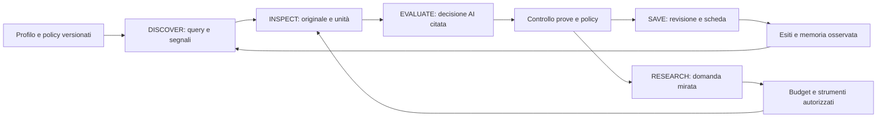

# CustomerSearch — architettura AI-first proposta

**Stato: progetto, non implementato.** Fase 1, 20 ottobre 2026. Le motivazioni e i limiti sperimentali sono nell'[audit](CUSTOMERSEARCH-AI-FIRST-AUDIT.md). Nessuna promessa di due clienti mensili: quello è l'obiettivo di prodotto da misurare con esiti reali.

## 1. Decisione architetturale

Un'app locale Python/SQLite con UI esistente, un worker e un solo decisore commerciale AI. Cinque flussi preservati come strategie/configurazioni e attribuzione dei risultati, non cinque agenti autonomi. Nessun microservizio, database vettoriale o framework di agenti è necessario per risolvere i problemi osservati.

L'AI interpreta compatibilità, domanda, utilità del contatto e valore del prossimo approfondimento. Il codice decide se un'azione è autorizzata/eseguibile e se una citazione esiste, appartiene al documento e riguarda il soggetto corretto. Il codice **non** decide che la parola “università” rende un produttore un'istituzione né che data ignota renda inutile una candidatura spontanea.

Le preferenze esplicite di Diego (territori, esclusioni, nessun PDF, nessun invio automatico) rimangono policy operative. Una preferenza si applica soltanto a un fatto attribuito: la forma giuridica di un fornitore non esclude il suo cliente.

## 2. Pipeline e responsabilità



1. **DISCOVER.** Planner propone poche query con soggetto, ipotesi commerciale, fonte attesa, prova decisiva e stop condition. Normalizzazione, PDF, sintassi, territorio e dedup verificati dal software. La pertinenza commerciale è un giudizio esplicito del planner, non una lista obbligatoria di keyword web/cerchiamo. Query senza ipotesi non eseguita; proposta alternativa ammessa anche se non coincide con template.
2. **INSPECT.** Risultati Serper sono indizi. Filtri economici solo strutturali/accesso/duplicati; breve GET autorizzato sulle pagine plausibili prima di spendere chiamate su ogni snippet. Il sistema conserva immediatamente acquisizione e metadati, segmenta eventuali annunci, separa editore e soggetti. Uno snippet può motivare una visita, mai qualificare da solo un progetto o una richiesta.
3. **EVALUATE.** Il modello riceve profilo, prove originali selezionate, relazioni, date, contraddizioni e risultati precedenti. Produce una decisione commerciale motivata e al massimo una prossima azione principale. Le omissioni restano UNKNOWN; non si generano missing obbligatori in base a un unico schema di annuncio.
4. **VALIDATE.** Validazione strutturale del JSON e riferimenti, coerenza degli attori/unità, budget e policy. Se una parte è invalida, conservarne le altre; porre in attesa la sola affermazione/azione dipendente, non tutti i candidati del batch. Citazioni semanticamente discutibili diventano contestazioni esplicite, non riparazioni invisibili.
5. **RESEARCH IF NEEDED.** Solo se una domanda irrisolta può cambiare la decisione o rendere utilizzabile il contatto. Il task conserva expected subject/unit, criterio di successo, costo massimo, tentativi precedenti. Nessun inseguimento automatico di tutti i link di un dominio.
6. **SAVE.** Revisione immutabile, decisione commerciale e stato tecnico separati, proiezione UI unica. Save non implica invio o accettazione di un contratto.

### Cinque flussi, diversi motivi di interesse

| Flusso | Prima prova utile | Possibile esito INTERESTING | Quando approfondire/fermare |
|---|---|---|---|
| AZIENDE | Richiesta di sviluppo oppure attività e problema commerciale documentato | Progetto completo esplicito; prospect proattivo con ragione concreta | Sito presente/vecchio/PSI basso non basta. Se intervento minimo, nessuna proposta di rifacimento. |
| AGENCIES | Pagina ufficiale inviti/portfolio/candidature o richiesta incarico | Freelance aperto, candidatura spontanea pertinente, partner proattivo motivato | Non richiedere annuncio datato per invito permanente. Se vende soltanto servizi, serve un motivo ulteriore per proporre partnership. |
| SOCIAL | Post originale, autore e richiesta separati da commenti/condivisioni | Domanda attribuita e attuale, con canale di risposta lecito | Snippet/accesso bloccato → ricerca di fonte ufficiale, mai login o scraping vietato. |
| STARTUPS | Progetto da sviluppare e forma del rapporto | Contratto oppure opportunità imprenditoriale, in liste distinte | Funding non è budget di sviluppo. Equity/ruolo cofounder non è lavoro pagato. Rischi non delimitati → ricerca o giudizio negativo motivato. |
| NEWS | Evento attribuito, data e collegamento all'impresa | Prospect con lacuna indipendente verificata, non evento da solo | Archivio di notizie/pubblicazione istituzionale non è cliente. Se sito già rappresenta il cambiamento, fermarsi. |

## 3. Semantica commerciale multidimensionale

Gli otto tipi richiesti mescolano rapporto, servizio e maturità della prova. Usare **due assi principali** e pochi attributi, non otto classi mutuamente esclusive.

- `relationship`: EXPLICIT_REQUEST, OPEN_FREELANCE_COLLABORATION, SPONTANEOUS_APPLICATION, PROACTIVE_OUTREACH, EQUITY_PARTNERSHIP, BUSINESS_SIGNAL.
- `service`: WEBSITE_NEW, WEBSITE_REBUILD, ECOMMERCE, WEBAPP_MVP, FRONTEND_SUPPORT, UNKNOWN; più servizi ammessi se giustificati.
- `compensation`: PAID, EQUITY_ONLY, UNPAID, MIXED, UNKNOWN, con prova. “Freelance” non dimostra importo o contratto disponibile.
- `open_paid_project`: CONFIRMED, NOT_CONFIRMED, UNKNOWN; CONFIRMED richiede richiesta attuale e rapporto retribuito documentato. Budget può essere UNKNOWN.

Proiezioni compatibili: EXPLICIT_PAID_REQUEST solo con compenso retribuito provato; OPEN_FREELANCE_COLLABORATION e SPONTANEOUS_APPLICATION dal rapporto; PROACTIVE_WEBSITE_PROSPECT da rapporto proattivo+servizio website; ECOMMERCE_OPPORTUNITY e WEBAPP_MVP_OPPORTUNITY dal servizio con ragione commerciale; STARTUP_EQUITY_OPPORTUNITY dal rapporto equity; BUSINESS_SIGNAL quando resta solo un segnale. Una richiesta esplicita con compenso ignoto si presenta come “Richiesta esplicita — compenso da confermare”, senza falsificarne il tipo.

Le fasce 2–4 mila euro per sito e da 5 mila per e-commerce sono contesto del profilo, non stime aziendali. Un importo dichiarato insufficiente orienta il giudizio AI sullo specifico ambito. Collaborazioni continuative/frontend/supporto vanno valutate per giornata o rapporto; la soglia di un sito completo non si applica automaticamente a una giornata di collaborazione. Questo aggiornamento di policy deve essere approvato con l'architettura, non applicato retroattivamente.

### Decisione, fiducia e contatto

| Campo | Semantica proposta |
|---|---|
| `decision` | INTERESTING: utile proporlo a Diego; NOT_INTERESTING: incompatibilità o basso valore motivato; NEEDS_RESEARCH: domanda decisiva e verifica possibile. |
| `COMMERCIAL_INTEREST` | HIGH/MEDIUM/LOW/UNKNOWN con motivazione e prova; prodotto dal decisore, non da legacy state. |
| `EVIDENCE_CONFIDENCE` | HIGH/MEDIUM/LOW/UNKNOWN: affidabilità di identità, attribuzione, tempo e fonti; non probabilità di vendita. |
| `CONTACT_READINESS` | AVAILABLE/MISSING/BLOCKED/UNKNOWN: canale attribuito e stato accesso; disgiunto dall'interesse. |
| `OPPORTUNITY_QUALIFIED` | Decisione INTERESTING accettata, nessun conflitto critico, ragione specifica coerente col tipo. Non richiede un incarico aperto per partnership. |
| `CONTACT_AVAILABLE` | Email/telefono/form/pagina candidatura o risposta al post verificati e attribuiti; niente indirizzi dedotti. |
| `READY_FOR_OUTREACH` | OPPORTUNITY_QUALIFIED + canale utilizzabile + nessuna soppressione CRM/policy + prove entro la finestra di revisione del tipo. Non autorizza invio. |

INTERESTING può esistere con contact missing: una verifica contatti può aumentare la readiness senza cambiare il giudizio. Una firma email in un annuncio estraneo non rende CONTACT_AVAILABLE. Un invito professionale permanente può essere HIGH con budget, publication_date e open_paid_project ignoti. Se non si può attribuire l'invito al soggetto, il modello può proporre interesse provvisorio ma il risultato non è qualificato/esposto come pronto.

### Stati tecnici e storico

Nuovo asse tecnico: DISCOVERED, ACQUIRED, PARTIALLY_ACQUIRED, VALIDATED, ACCESS_BLOCKED, MODEL_INVALID, RETRY_PENDING. Nessuno significa automaticamente NOT_INTERESTING.

I vecchi VERIFIED, POTENTIAL, NEEDS_REVIEW, UNVERIFIABLE, REJECTED rimangono salvati come `legacy_state`. Adapter di sola lettura: VERIFIED/POTENTIAL sono valutazioni precedenti da esporre con versione, non conversione automatica in nuova decisione; REJECTED mantiene motivo/epoca e può richiedere rivalutazione; UNVERIFIABLE è stato tecnico; NEEDS_REVIEW non equivale a scarso interesse. Il report storico non cambia quando una nuova proiezione viene aggiornata.

## 4. Contratti delle prove

### EvidenceDocument

Campi richiesti: id, hash contenuto, requested_url, final_url, redirect_chain, status, content_type, observed_at, acquisition_method, extraction_version, access_status. `headers` solo whitelist (Last-Modified, ETag, Cache-Control, Date); mai Cookie/Authorization. HTML/raw body conservato privatamente secondo limiti già esistenti, testo visibile separato e mappa offset verso originale. Dati preesistenti privi di HTML restano `raw_available=false`, senza ricostruzioni spacciate per originali.

### DocumentUnit e EvidenceClaim

`DocumentUnit`: id = hash(document_version + locator), type PAGE/ARTICLE/JOB/POST/COMMENT/LISTING, parent, intervallo testo, DOM locator/JSON pointer, heading, dichiarazione di soggetto, candidati date, link etichettati. Unità non separabile → scope UNKNOWN; non assemblare un annuncio prendendo dati da righe vicine.

`EvidenceClaim`: id, document_id/version, unit_id, subject_id oppure unresolved, predicate, value, quote/segment IDs, offsets, extraction_method, modality FACT/INFERENCE/HYPOTHESIS/UNKNOWN, observed_at, conflicts, verification. Gli UNKNOWN non hanno quote fittizie. Le inferenze citano le premesse e dichiarano il passaggio logico. Un fatto estratto dall'AI resta una proposta finché esistenza e attribuzione sono verificate.

Metadati raccolti e mantenuti distinti:

| Canale | Campi | Uso/limiti |
|---|---|---|
| HTML | title, description, h1–h6, main content, link con etichetta/contesto, contatti, time/datetime/itemprop | Boilerplate identificato, non cancellato dall'archivio; unità annuncio distinguibili. |
| Open Graph | og:title, og:description, og:url, article:published_time/modified_time | Prove sulla pagina; og:url è candidato canonical, non attestazione di dominio ufficiale. |
| JSON-LD | Organization, LocalBusiness, JobPosting, hiringOrganization, datePosted/datePublished/dateModified, validThrough, employmentType, applicantLocationRequirements | Conservare oggetti e JSON pointer; più JobPosting → più unità, non primo elemento indiscriminato. |
| HTTP | URL iniziale/finale, redirect con status, status/mime, Last-Modified/caching | Data di trasporto non prova di attualità della vacancy. |
| Canonical | rel=canonical, og:url, redirect | Archi alternativi dichiarati; non merge automatico tra domini. |
| Sitemap | URL, lastmod, relazione sitemap→pagina | Discovery e priorità di refresh, mai data certa dell'annuncio. |
| RSS/Atom | feed id, entry id, published/updated, link originale | Data del feed distinta dalla pagina; dedup per evento e contenuto. Non abilitare fonti non configurate. |
| Visibile | date/scadenze/posizione chiusa, inviti, competenze, sede, contratto | Assegnazione all'unità, non alla prima data del documento. |
| Pagine correlate | about/contact/careers/partnership/services/portfolio | Ogni visita deve rispondere a una domanda; portfolio completato non è richiesta nuova. |

## 5. Date: modello e decisione

Ogni TemporalClaim contiene `role` (published_at, modified_at, observed_at, expires_at, last_verified_at), `subject` (document/unit/request/event), raw value, parsed value o intervallo, timezone se nota, precision (instant/day/month/year/relative), origin (JSON pointer/DOM/span/header/feed), explicit/inferred, confidence, checked_at e conflict_group.

- Date senza timezone: mantenere giorno/precisione locale e timezone UNKNOWN, non inventare mezzanotte UTC. Una data parziale è intervallo, non giorno inventato.
- “3 giorni fa” è inferenza ancorata all'acquisizione, non data assoluta certa; rendere l'intervallo e la dipendenza dalla fonte.
- Date future: publication anomala/da verificare; expires_at futura valida come scadenza, non rifiutata dal parser delle pubblicazioni.
- Dati contrastanti non si risolvono scegliendo sempre il più recente. JobPosting associato alla stessa unità e testo etichettato possono corroborarsi; copyright, RSS updated e Last-Modified restano ruoli diversi.
- Annuncio 2015 online nel 2026: STALE per incarico attuale. Una data di revisione del sito non riapre l'annuncio.
- Pagina permanente ufficiale “Collabora con noi”, invito professionale presente, nessuna chiusura: `EVERGREEN_INVITATION_OBSERVED`. Publication UNKNOWN ammessa; last_verified_at significa verifica della pagina, non conferma di incarichi disponibili.
- Se invito è vecchio, copiato da archivio, il sito è abbandonato o pagina contraddetta: NEEDS_RESEARCH. “Evergreen” non è una scorciatoia basata sull'URL careers.

Finestre proposte configurabili per revisione prima del contatto: incarichi/social 14 giorni dalla verifica, inviti permanenti 30, prospect aziendali 60. Sono TTL di controllo, non durata garantita del bisogno e non modificano gli attuali limiti in Fase 1. Chiusa/scaduta prevale subito.

## 6. Identità e relazioni

Separare SiteOwner, Publisher, Author, MentionedCompany, Requester, Intermediary, Supplier, Customer e HiringOrganization. Una stessa entità può avere più ruoli **in unità differenti**.

EntityCandidate conserva nomi/alias, dominio candidato, legal ID se pubblicato, indirizzi, provenienza e stato. Entity resolution usa evidenze concordanti: nome completo/brand, footer/contact, link ufficiale, identificativi pubblici e relazioni dichiarate. Non richiedere partita IVA per ogni freelance e non unire omonimi per nome.

Ogni merge è una decisione con supporting edges e controprove; reversibile e versionata. Dominio registrabile è una chiave candidata, non prova esclusiva: tenant, sottodomini e agenzie multi-brand richiedono attenzione. Non aggiungere una dipendenza per public-suffix senza valutazione nell'implementazione.

Controllo di dettaglio: un link dalla card Elice deve portare a una pagina con lo stesso attore/richiesta o un'identificazione equivalente. Se porta a ilGiornale, archiviare l'errore di relazione; il documento Elice rimane nel dossier Elice, quello ilGiornale non ne conferma la richiesta. Il result_id è un identificatore di lavoro, non un'autorizzazione a unire soggetti.

Directory ReportAziende: editore Media Asset distinto dal produttore citato; nessun link ufficiale verificabile → domanda mirata sull'impresa, non audit del dominio dell'editore. Punto Infissi→Oknoplast: `RESELLER_OF`, non SAME_ENTITY o SUBSIDIARY_OF.

## 7. Decision engine e ricerca mirata

Contratto proposto (schema strutturato versionato):

```json
{
  "candidate_id": "opaque-id",
  "subject_id": "resolved-or-null",
  "decision": "INTERESTING | NOT_INTERESTING | NEEDS_RESEARCH",
  "relationship": "enum",
  "services": ["enum"],
  "commercial_reason": "specifica per Diego",
  "profile_fit": {"level": "HIGH | MEDIUM | LOW | UNKNOWN", "reasons": []},
  "supporting_claim_ids": [],
  "counter_claim_ids": [],
  "unknowns": [{"field": "scope", "decision_relevance": "why"}],
  "uncertainties": [],
  "commercial_interest": "HIGH | MEDIUM | LOW | UNKNOWN",
  "evidence_confidence": "HIGH | MEDIUM | LOW | UNKNOWN",
  "priority": "HIGH | NORMAL | LOW",
  "contact_claim_ids": [],
  "urgency_claim_ids": [],
  "next_action": {"type": "REVIEW_OUTREACH | FETCH_PAGE | SEARCH | BROWSER_CHECK | STOP", "reason": "specifica", "resolves": [], "success_condition": "verificabile"}
}
```

Schema illustrativo: gli array hanno limiti, i claim IDs sono solo quelli forniti; gli enum effettivi e la nullability saranno formalizzati prima del primo prompt. Nessun endpoint, path locale, SQL, comando shell o email body eseguibile nel contratto. REVIEW_OUTREACH prepara una proposta da rivedere, non invia.

Criticità invalida un'affermazione dipendente, non tutte: ad esempio contatto non attribuito → CONTACT_AVAILABLE false; richiesta commerciale ancora valida se sostenuta da altre prove. Identità sbagliata o fonte inventata → decisione non qualificabile, task di verifica/fallimento tecnico esplicito. Valutazione e verifica hanno revisioni separate; nessun punteggio alto supera un conflitto critico.

`ResearchAction`: action_id stabile, campaign/candidate, decision_revision, question, allowed_tool, target/subject, parent, depth, prior_attempts, evidence_version, max_cost envelope, success/stop criteria, idempotency_key. Esito RECEIPT registra acquisizioni, nuove prove, utilità rispetto alla domanda, costo/latency/error. Se il documento non cambia e non c'è una nuova domanda, dedup e stop; niente ricerca per “compilare tutti i campi”.

## 8. Allocazione e controllo dei costi

Riutilizzare i massimi configurati e il ledger atomico. Nessun aumento automatico né prenotazione implicita di una nuova campagna. La cifra monetaria è stimata con tariffe configurate; saldo fattura e crediti non sono interrogati.

Proposta iniziale da validare, **non configurazione applicata** per 100 chiamate: fino a 5 piani iniziali, 5 ripiani, 10 screening AI solo su risultati ambigui, 55 valutazioni di originali, 25 verifiche/completamenti. Sono riserve elastiche e con release esplicita, non obbligo di spendere ogni quota. Massimi per flusso/candidato esistenti prevalgono. Per budget piccoli fare un ciclo completo su meno candidati, non cinque flussi di soli piani.

Preferenza di esplorazione indicativa AGENCIES 35%, AZIENDE 30%, STARTUPS 15%, SOCIAL 15%, NEWS 5%, motivata dalle due piste concrete delle agenzie e dall'assenza di originali utili NEWS nella 43. Tutti i cinque flussi mantengono un primo tentativo se il budget lo consente. **Non è una stima di conversione né una quota ottimale dimostrata**. Redistribuzione sulla resa delle prove, mai per penalizzare un blocco HTTP come assenza di mercato.

Scheduler ordina proposte per utilità commerciale motivata, capacità di risolvere un'incertezza (alta/media/bassa, non percentuali inventate), costo stimato, eseguibilità, tentativi e saturazione. Prima completa dossier quasi utilizzabili; poi esplora. La valutazione AI propone priorità, il software applica envelope/safety/fairness. Discovery si ferma se non resta capacità per valutare almeno un originale.

Massimo iniziale proposto: due azioni successive per domanda, profondità due, una riparazione di output con prove immutate; limiti tecnici configurabili e revisionabili. Un nuovo fatto sostanziale può aprire una domanda nuova. Timeout e backoff distinguono 429/5xx, robots temporaneo, blocco esplicito, output invalido. Retry non crea nuovo credito disponibile. Stop invalida generation, interrompe i processi posseduti e respinge salvataggi tardivi; resume riusa receipt/evidenze/ledger e non ripete una chiamata completata.

## 9. Dati e migrazione additiva

Nuovo namespace proposto `ci_` in SQLite, senza rinominare/cancellare tabelle esistenti:

| Tabella | Chiave e contenuto | Invariante |
|---|---|---|
| ci_documents | document_version PK, legacy_document_id, hash, acquisition metadata, extractor_version | Immutabile; unicità contenuto+URL+metodo/versione. |
| ci_units | unit_id PK, document_version FK, locator, spans, type | Ogni prova appartiene a versione e unità precise. |
| ci_entities / ci_entity_links | entity_id, alias; link con tipo/evidence/status/revision | Merge espliciti reversibili; niente directory owner implicito. |
| ci_claims | claim_id, unit_id/subject FK, predicate/value, refs, modality, verification | Nessun claim senza provenienza salvo UNKNOWN esplicito. |
| ci_decisions | id, candidate/request key, revision, model/config/schema, decision, reason, evidence_set_hash, supersedes | Append-only, una revisione attiva via indice/proiezione. |
| ci_actions / ci_receipts | idempotency key UNIQUE, parent, generation, intent, status, ledger reference | Claim atomico e receipt una sola volta; retry tentativi separati. |
| ci_legacy_links | tabella/id storico → entity/request/document/decision | Navigazione e CRM conservati; legacy state immutato. |
| ci_review_events | decision_id, author/source, verdict, correction, timestamp | Append-only, distinto da note/esito commerciale. |

Riutilizzare campaigns/research_tasks e commercial_ai_executions, senza un secondo contatore di costo. I dettagli delle azioni sono sidecar della coda; i record legacy rimangono leggibili. Schema version allocator verificato contro `research_schema` all'implementazione, non numero arbitrario qui.

Migrazione in transazione: backup coerente verificato, DDL additive/idempotenti, mapping solo dove provato, nessuna promozione massiva. Poi backfill offline a lotti con checkpoint e raw unavailable esplicito. Modello e inferenze non partono durante la migrazione. Proiezione dual-read selezionata da engine_version; risultati di vecchie campagne esplicitamente marcati come valutazioni storiche.

## 10. API e UI

Preservare endpoint storico e CRM; introdurre namespace proposto `/api/intelligence` con contratto unico:

- GET `/opportunities?decision=&relationship=&service=&flow=&region=&readiness=&stage=&campaign=&cursor=`: proiezione con counts dello stesso filtro.
- GET `/opportunities/{id}`: prove, unità, timeline, decisioni e limiti.
- POST `/opportunities/{id}/review`: revisione manuale versionata, CSRF, idempotency key; niente inferenze implicite.
- GET `/campaigns/{id}/progress`: query/URL/unità/aziende/dossier valutati/interessanti/pronti, costi e motivo di arresto separati.
- Start/stop/resume restano sulle API campagne con engine_version e preview espliciti; nessun default legacy silenzioso per nuove campagne AI-first.

Scheda leggibile in pochi secondi: nome+sito, “Collaborazione freelance aperta”, motivo specifico, servizio pertinente, due prove con date, contatto, prossima azione. Badge separati “Invito permanente osservato”, “Nessun incarico aperto confermato”, “Budget ignoto”. Dossier espanso per rischi, obiezioni e revisioni. “Da contattare” include partnership utilizzabili, filtro distinto per commesse/equity. Conferma contatto, sfondo verde, elimina/ripristina, pipeline e bozze restano.

Esempio progettuale da prove congelate: **Kondividi — collaborazione freelance**. Perché: invito ufficiale a professionisti web con partita IVA. Servizio: supporto web/frontend da proporre in base al portfolio. Fonte: pagina web-agency-modena, osservata nel dataset; contatto `cv@kondividi.it`. Passo: Diego revisiona la proposta di presentazione. Incarico aperto, compenso e volumi UNKNOWN; nessun messaggio generato/inviato in questa fase.

## 11. Sicurezza, test e apprendimento

Conservare rete a IP pubblici fissati, TLS, controllo redirect/robots, esclusione PDF, limiti browser, escaping/CSP/CSRF e backup privati. Il modello non legge `.env` e non controlla endpoint/headers. Azioni possono visitare solo URL validati e non eseguono login, moduli, acquisti, shell, SQL o messaggi. Prompt injection inserita anche in metadati/JSON-LD/memoria è dato non fidato; citazione valida non autorizza un comando.

Log minimizzato con IDs, code, durata, consumo e passaggi rifiutati; niente chiavi/cookie/payload interi. Per replay conservare snapshot privati con hash e policy di esportazione. Nuove prove modificano il giudizio con supersedes; esiti umani e CRM hanno precedenza sulle priorità. Esclusioni manuali persistono fino a ripristino, non vengono annullate da un nuovo modello.

La memoria misura azioni eseguite e risultati verificati, non numero di piani chosen. Quarantena logica delle vecchie selezioni mai inviate (come 43), senza riscriverle. Distinguere rejection commerciale, errore tecnico, input insufficiente e giudizio umano. Non creare blacklist permanenti da un esperimento. Conversioni e suggerimenti di canale mostrano denominatori e finestre; nessun apprendimento predittivo dichiarato finché non esiste un esperimento appropriato.

## 12. Decisioni ancora da dimostrare

Il modello attuale non è stato eseguito sul nuovo contratto. Precisione, richiamo e vantaggio di costo dell'architettura sono **non misurati**. L'allocazione proposta e le finestre di revisione sono ipotesi operative da validare con il benchmark e poi una prova autorizzata. L'architettura può ridurre scarti errati e lavoro inutile; non può dimostrare che le aziende risponderanno o acquisteranno.
