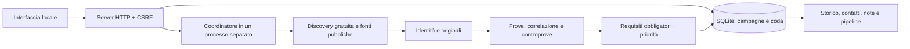

# CustomerSearch 4.0 — decisioni architetturali

## Base e conservazione

Analizzati README, documentazione, database, moduli `sales/`, frontend e suite precedente. A/B cercavano soprattutto richieste e collaborazioni; C richiedeva un progetto web dichiarato; D misurava difetti tecnici; E combinava segnali dello stesso dominio. L’orchestratore viveva in un thread del server, con query per sessione e stato non riprendibile. Sono mantenuti HTTP locale, SQLite, protezioni delle letture, estrazione, audit, CRM e frontend senza dipendenze esterne.

La nuova pipeline non usa le vecchie regole C/D per promuovere risultati. Il codice precedente resta per storico, bozze e audit manuali. La priorità commerciale 4.0 è distinta dal vecchio punteggio e dallo stato della trattativa.

Backup iniziale: `data/backups/20261013T152552430651Z`. Migrazione additiva, transazionale e ripetibile; nessuna rimozione delle tabelle precedenti. Verifica di ripristino e confronto delle righe in `scripts/verify_migration4.py`. Sulla base reale conservati 15 aziende, 21 schede, 69 prove, 19 interazioni, 132 record d’archivio, 1 eliminazione e 5 esclusioni. Configurazione del modello locale aggiunta senza cancellare credenziali.

## Coordinatore e coda

`sales/campaigns.py` possiede il processo `sales.research_worker`. Una campagna attiva per database, protetta anche da indice univoco. La coda SQLite conserva URL, strategia, parametri, pagina, impronta, tentativi e disponibilità. Le assegnazioni avvengono con `BEGIN IMMEDIATE`; candidati, fonti e query si alternano per evitare che un portale occupi tutta la ricerca.

Due letture HTTP concorrenti per candidato, una query SearXNG alla volta, almeno due secondi tra chiamate reali al provider. Modello e browser sono seriali nel worker. Robots e ritmo per dominio condivisi fra le letture del processo. La cache non attribuisce una nuova data di consultazione a una pagina vecchia.

Nessun tetto cumulativo di query, candidati o durata. Le strategie iniziali combinano territori, settori ed eventi, poi paginano finché trovano URL nuovi. La frontiera esaurita termina con uno stato esplicito. Tre errori ripetuti del provider sospendono la sua coda, mentre proseguono fonti indipendenti e candidati già scoperti. Riprendi riabilita i tentativi, senza far finta che il servizio sia tornato disponibile.

Timeout per operazione: letture pubbliche 12 secondi, ricerca 25, chiamata al modello 180, avvio browser 30 e singolo Lighthouse 120. Dimensione del documento HTML limitata a 1,5 MB; retry tecnici al massimo tre per operazione. Sono protezioni tecniche, non scadenze della campagna.

Stop invalida prima il token di generazione in una transazione, poi termina il gruppo del processo posseduto, inclusi eventuali figli Chrome/Node. Una scrittura tardiva non può promuovere una scheda. Il lavoro assegnato ma non concluso torna in coda. Dopo riavvio i lavori rimangono sospesi; la ripresa è manuale. Processi recuperati vengono identificati tramite PID, comando, database e campagna prima della terminazione.

## Dati e API

Tabelle `research_*`: versione, identità, domini verificati, documenti, segnali, valutazioni, revisioni, eventi, fonti, memoria di query e URL. `campaigns` e `research_tasks` separano esecuzione e verifiche. L’identità legale verificata precede il dominio; un dominio con identità societarie discordanti viene bloccato.

Una promozione scrive valutazione e collegamento al CRM nella stessa transazione. Mantiene fonti/citazioni anche nelle tabelle storiche, rendendo disponibili bozze e dossier precedenti. Le valutazioni successive sono registrate separatamente; una revisione negativa conserva il risultato originale nel corpo e nella cronologia delle revisioni.

| API | Funzione |
|---|---|
| `POST /api/campaigns` | Nuova campagna, target predefinito 50, filtri `projects`, `regions`, `groups` |
| `GET /api/campaigns` | Ultime campagne, stati e contatori |
| `GET /api/campaigns/{id}` | Dettaglio e impedimenti |
| `POST /api/campaigns/{id}/stop` | Invalidazione e arresto |
| `POST /api/campaigns/{id}/resume` | Ripresa della coda |
| `GET /api/opportunities` | Paginazione e filtri `status`, `project`, `region`, `group`, `campaign`, `stage`, `search` |
| `GET /api/opportunities/{id}` | Dossier, prove, documenti e revisioni |
| `POST /api/opportunities/{id}/review` | `confirmed`, `false_positive`, `missed_opportunity`, con motivo |

Il vecchio `/api/research` avvia la nuova campagna. Le API delle schede commerciali rimangono compatibili. Qualificazione (`qualified`, `needs_review`, `rejected`, `unverifiable`) e pipeline commerciale sono indipendenti.

## Prove e modello

Ogni documento conserva URL, testo leggibile, hash, provider, data pubblicata e data di lettura. I riferimenti del modello devono indicare documenti reali e citazioni letteralmente presenti. Schemi JSON controllati anche dal server; campi aggiuntivi o citazioni inventate invalidano l’analisi.

Qwen2.5 7B locale estrae prove per pagina, formula una proposta e svolge una seconda revisione critica. Testi commerciali suddivisi in estratti; footer legali conservati per l’identità, ma esclusi dal testo principale sottoposto al modello. Le pagine sono dati non fidati: nessuna istruzione contenuta nelle fonti autorizza azioni. Il modello non sceglie punteggi, contatti, invii o acquisti.

Le fonti editoriali vengono separate dai committenti. Nomi citati e citazioni vengono controllati; si cercano collegamenti ufficiali e, se mancanti, query di risoluzione. La concordanza incerta tra omonimi non qualifica. Documenti precedenti sono correlati solo tramite identità verificata, non semplicemente per nome.

Somiglianza dei contenuti, impronte e sovrapposizione delle citazioni evitano di moltiplicare comunicati ripubblicati. Questo è un criterio conservativo e può accorpare riscontri simili: non è una risoluzione semantica universale degli eventi.

## Requisiti e priorità

Tutti i requisiti obbligatori devono passare; il punteggio non li sostituisce. Pesi: prove 20, bisogno 25, tempestività 10, progetto completo 15, compatibilità economica documentata 10, fattibilità 10, canale 5, riscontri distinti 5. Soglia 70. Confronti pubblici tra fornitori documentati possono ridurre la priorità; nessun numero di concorrenti viene inventato.

Budget ignoto non aggiunge punti né viene sostituito da 2.000/5.000 €. Le soglie sono del servizio offerto. La verifica rifiuta salari, fatturato e budget attribuiti al cliente finale dell’agenzia. Quote tecniche o ordini email non dimostrano un bisogno di progetto completo. Una richiesta dipendente non è una commessa.

Le assenze non vengono dedotte da snippet o da una scansione parziale. Soluzioni esistenti e collegamenti ufficiali a shop/portali esterni sono controprove; una pagina necessaria illeggibile impedisce la validazione approfondita. Lighthouse viene eseguito come supporto dopo i requisiti commerciali, e non aumenta la priorità. Le schede distinguono citazioni, inferenza di progetto e incognite.

## Memoria ed esiti

Una sola unità per identità nella campagna, anche con più fonti o domini. Eliminazione e “Non contattare” controllati anche al momento della promozione. Contatti già gestiti restano nello storico e non rientrano nei nuovi 50. Segnali invariati non provocano nuove proposte in campagne successive.

Le correzioni manuali di categoria, gli importi, le note e gli stati rimangono autorevoli. Gli esiti possono cambiare l’ordine delle strategie soltanto con almeno 10 contatti effettivamente registrati per coorte; risposte e clienti sono misurati sullo stesso denominatore. Nessun modello predittivo e nessun allentamento dei requisiti.

## Sicurezza e limiti deliberati

Host/Origin/CSRF, CSP, escaping, dimensioni delle richieste e backup non pubblici conservati. Letture pubbliche con verifica IP, DNS fissato alla connessione, redirect controllati, niente reti private o credenziali. Chrome passa attraverso un proxy con le stesse restrizioni di destinazione, incluse risorse e redirect; QUIC e UDP WebRTC disabilitati. Robots viene verificato prima della lettura del sito; il proxy TLS limita la rete, non interpreta percorsi cifrati o condizioni d’uso.

Nessuna integrazione autenticata con registri, portali professionali o dati riservati. Le condizioni d’uso collegate alle fonti iniziali vengono lette e i divieti riconosciuti bloccano la fonte; ciò non è una certificazione legale automatica. PDF e contenuti solo JavaScript non hanno un estrattore commerciale completo: il limite rimane visibile, senza promozione arbitraria. Un’azienda senza dominio ufficiale verificabile può rimanere in approfondimento; il sistema non dichiara che non possieda un sito.

Ollama viene avviato solo se già installato. Installazione esplicita in `scripts/setup_ollama.py`, runtime ufficiale v0.40.3 verificato con SHA-256 `a2d1d906a2c8febd9cb18f5c183854d0a6db5dc522940d68b0c0ed048e8dfdea`; modello `qwen2.5:7b`. Nessun provider a pagamento o cloud abilitato automaticamente.
